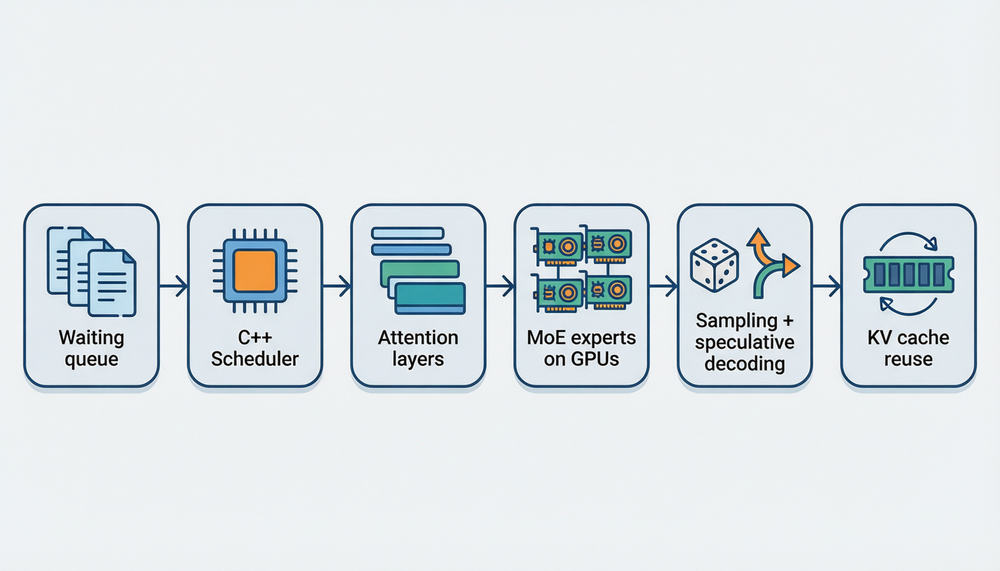
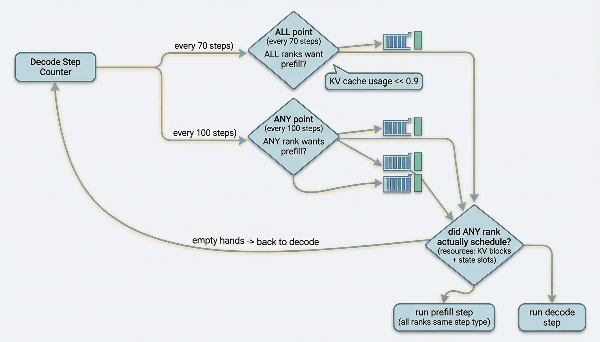
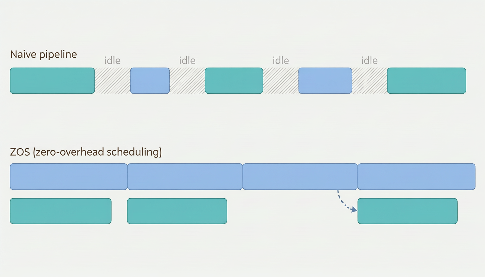
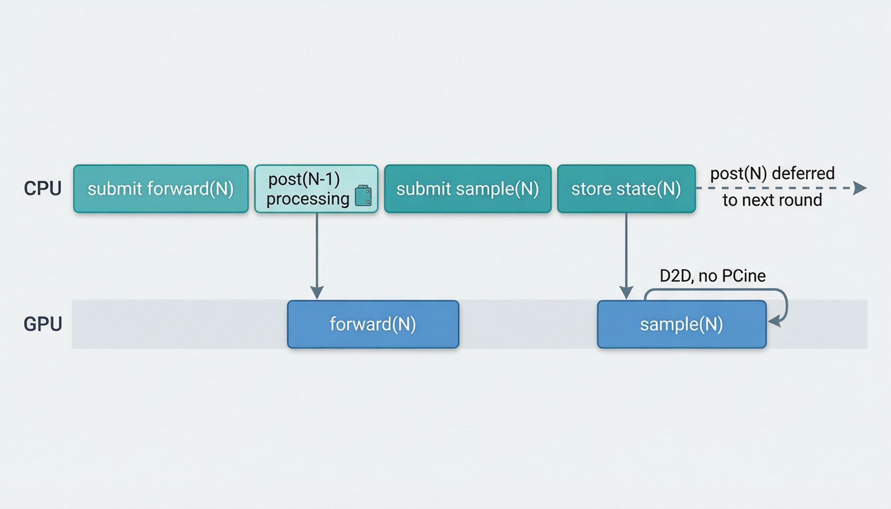
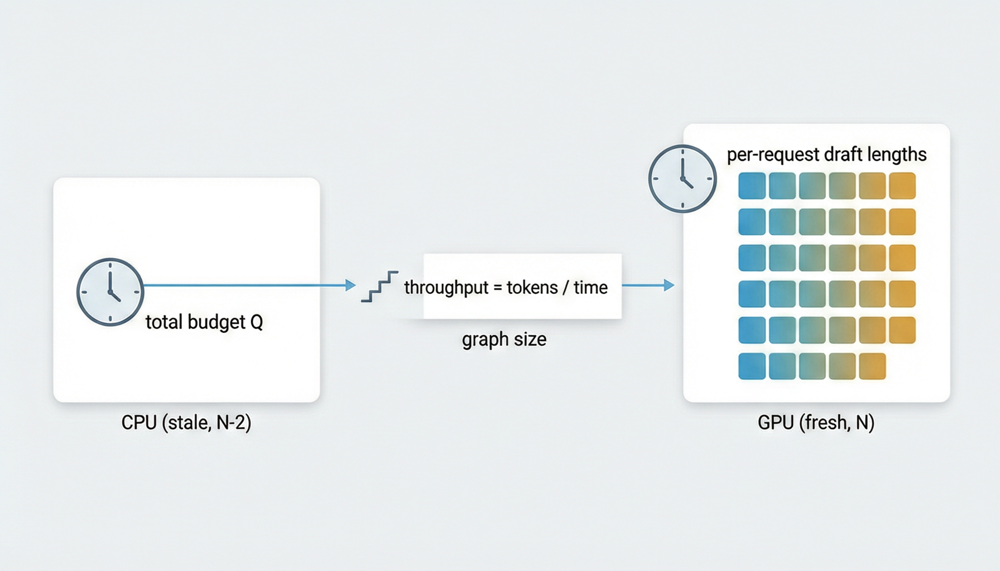
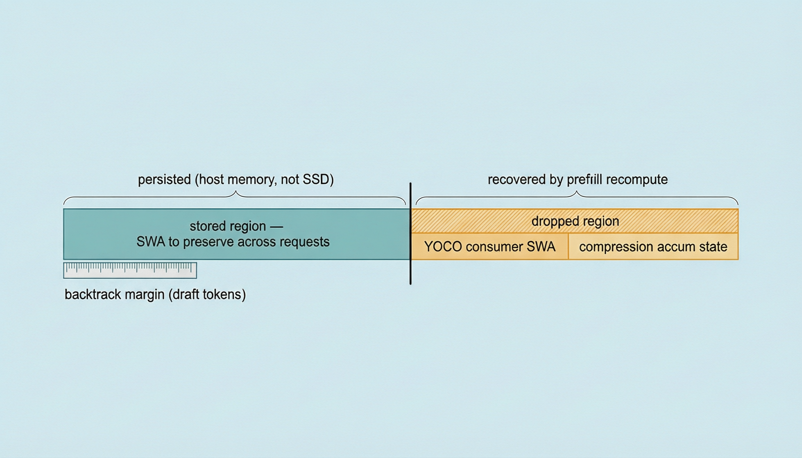
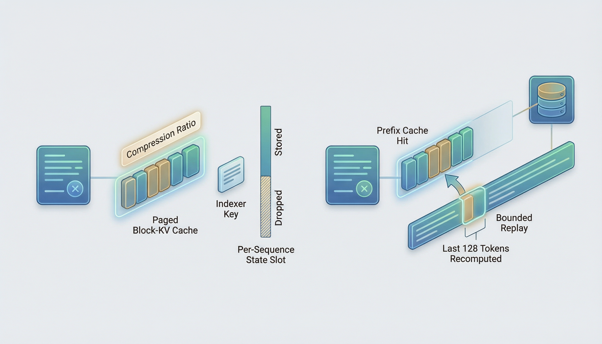
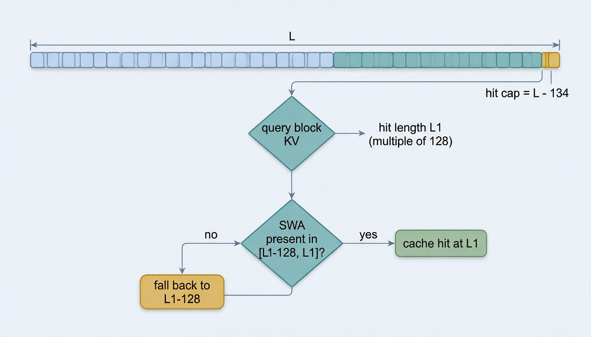
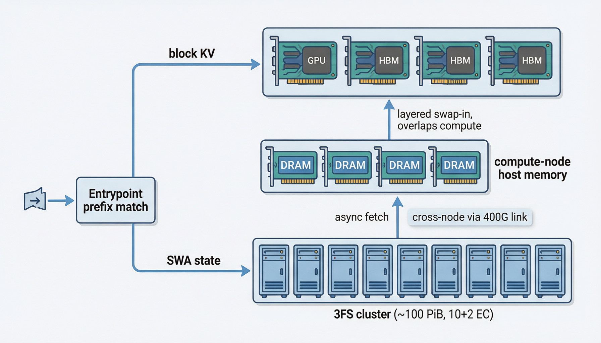
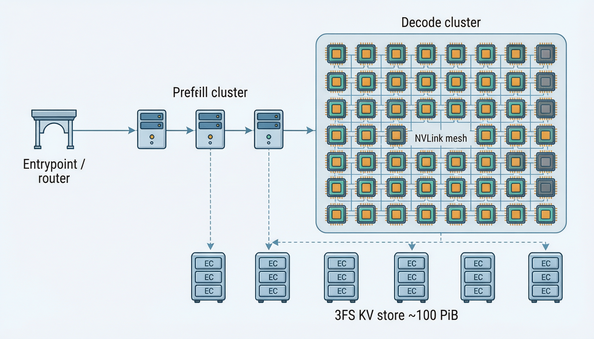

# 当所有框架都在做加法，做减法的 DeepInfer 走到了哪一步？

> DeepSeek 开源的推理引擎核心：没有 server、没有 TP、只支持一个模型——但日服务 155 万亿 token 的那台机器，引擎就在这个包里。本文跟着一条请求走完全程，把每一笔"减法"换来的东西，用源码证据拆给你看。

DeepSeek 把自家推理框架 DeepInfer 开源了：Apache-2.0、支持模型只有一个（DeepSeek-V4.1-Flash）、硬件只认 SM100 和昇腾 950。乍看是个"限定条件多得离谱"的开源包——通用框架早已遍地都是，谁会要一个只能跑一个模型的引擎？

但换个角度：DeepSeek 生产推理栈里真正的工程含量，大部分就压在这个包里。官方 Q&A 里那个日服务 155 万亿 token 的集群，它的 prefill/decode 引擎、调度器、缓存布局、投机解码，全部可以在这个仓库里找到对应物。**它不是又一个框架，而是"把一个模型压榨到极致"这件事的完整标本。**

这份代码乍读处处是"怪事"：

- 一个支撑生产规模的系统，开源包里却连 HTTP server 都没有——入口只有一个离线的 `LLM.generate`；
- 并行配置里根本没有 TP（张量并行）这个维度——不是没实现，是架构上就不需要；
- 调度器是 1300 余行的 C++，藏在一个 Python 框架的最深处；
- 有个变量叫 `state_size_to_disk`，数据却从不落盘；
- 投机解码每步验证多少个草稿 token，由两个"时钟"共同决定——CPU 拿着两轮前的置信度定总量，GPU 拿着最新的置信度做分配。

这些怪事没有一件是 bug，它们全是同一组设计张力的表面：**当你只为一个模型、一种超节点、一个目标（吞吐）做引擎时，可以砍掉什么、又必须把什么做到极致？** 这篇文章要拆的就是这个。

### 先把结论放在门口

（**推断**，基于全文证据；论证在正文逐站展开，这里先给立场，免得你读了两千行才发现这篇文章与你无关）

一句话：**SGLang 是大多数人的正确选择；DeepInfer 是少数场景的最优选择，和所有想做推理优化的人的必读材料。** 前半句是工程决策，展开成一张表：

| 你的情况 | 更合理的起点 | 一句话理由 |
| --- | --- | --- |
| 业务要跑多种模型、多种硬件 | SGLang | DeepInfer 的[配置断言](https://github.com/deepseek-ai/DeepInfer/blob/9bd9cf243fc53ef9afbf8f04d391d989117d6ab9/deepinfer/hugging_face/config.py#L51-L59)只认 V4.1-Flash + SM100/昇腾 950，换模型直接报错 |
| DeepSeek 模型 + 超节点 + 高吞吐优先 | DeepInfer | ZOS、DSpark、EPLB、模型结构焊进缓存布局这类激进优化，通用框架要么做不了，要么为兼容性打折 |
| 想学推理系统工程 | 两个都读，DeepInfer 精读 | 理由就是下面四条 |

给 DeepInfer 的两盆冷水也先摆出来，免得这个立场显得偏心：

- **它的生产数字有不可复现的部分**——日服务 155 万亿 token 的成绩背后是没开源的 3FS 集群、入口负载均衡和 Recipe 协议层（第 0、6 站）；你拿到的是那台机器的引擎，不是那台机器；
- **它是 DeepSeek 内部需求的投影，不是社区产品**——迭代节奏取决于 DeepSeek 自己的优先级；SGLang 的社区活跃度和多厂商贡献是另一种形式的保险。

那"必读材料"凭什么？四条理由，正文会逐站交出证据：

1. **它展示的不是技巧，是纪律。** 投机解码的回退余量写进缓存布局（5.3）、YOCO 截断穿透到残差流和六类跨层共享值（2.2/2.3）、EPLB 的目标函数直接对着"每步最慢 rank"而不是历史总量（3.3）——这些地方没有一个是"加了个聪明算法"，全是"把一个决定的全部下游后果写完"。技巧会被论文讲掉，纪律只有源码能教。
2. **它展示了闭环咬合的价值。** C++ 调度器、`forbid_cuda_sync` 硬守卫、GPU 侧长度修正——单拎任何一件业界都有先例（Q&A 也坦承异步调度沿用 SGLang / NanoFlow 的思路）；三件互相咬合成闭环，才是稀缺的东西。而咬合处的坑——在途抢占作废本步输出（1.5）、`schedule_cnt/process_cnt` 判定置信度旧到哪轮（4.5）、mtp slot 0 预留给 padding（4.3）——恰恰是读二手文章最容易漏掉的部分，因为它们不属于任何"特性"，只属于"特性之间的接缝"。
3. **它展示了"砍掉通用性能换来什么"。** 无 TP、配置断言、单模型假设（第 2、3 站）——你亲眼看到约束收窄之后，优化空间被推到什么程度：缓存格式精确到字节（5.3）、投票机制精确到死循环防护（1.1）、预算模型精确到 CUDA graph 档位（4.6）。这对"什么时候该写专用代码、什么时候该写通用代码"的直觉校准，比任何方法论文章都直接。
4. **它对"怎么防自己出错"同样诚实。** 性能曲线缓存与双层中位数、斜率钳到 0 防负耗时外推（4.6）、batch-invariant 的混批 vs 单条对拍（第 7 站）、mask/compact 等价校验（5.4）——一个把优化做到极致的系统，配套的自证机制也是同样的密度。这不是巧合：敢做激进优化的前提，是知道自己错得起。

SGLang 的代码是好的通用框架代码，DeepInfer 的代码是一个问题的完整解法——前者教你写框架，后者教你解题，而推理优化这件事，本质是解题。两者的逐维度对比在第 8 站。

带着这个立场，我们上路。方法上，跟着一条请求走完全程——想象你是一句话"帮我总结这份合同"，从敲下回车到变成回答流出来，中间发生了什么：

```text
你进入等待队列，前面还压着几百个"同伴"
    ↓
一个 C++ 写的调度器决定：这一步，GPU 上坐哪些请求？
    ↓
你被切成 token，穿过几十层结构各异的注意力层
    ——有的层只看最近的 128 个 token，有的层在读"压缩过"的历史
    ——有的层甚至不自己算 KV，直接借用前面层的
    ↓
你的 token 撞上 MoE，被打散到几十张卡上的专家那里算完再汇回来
    ↓
采样。但你不知道的是：在你还没被采样完时，
调度器已经在为"下一个你"铺路了
    ↓
你结束了。但你留下的 KV 和状态，会替"下一个问同样问题的人"省掉大半计算
```

每到一站，先问"这里卡在什么问题上"，再去源码里找 DeepInfer 的答案。全文九站：第 0 章划边界（开源了什么、没开源什么），第 1 站队列（C++ 调度器、投票与抢占），第 2 站主干网络（模型结构怎么变成执行差异），第 3 站 MoE（无 TP 的真相与 EPLB），第 4 站采样与投机（ZOS 与 DSpark），第 5 站缓存（bounded replay 与 3FS），第 6 站集群（官方 Q&A 口径），第 7 站确定性，第 8 站回到 SGLang 对比。



*图 0：一条请求的全程鸟瞰（AI 生成概念图，示意流程，非源码结构精确复现）*

所以它不是模块说明书，而是一次带证据的破案——每条论断都指向可以亲手核对的源码行。

## 第 0 章：出发前，先划清楚我们的地图

### 0.1 我们读的是哪一部分代码

源码仓库 [deepseek-ai/DeepInfer](https://github.com/deepseek-ai/DeepInfer)，文中所有源码链接均固定到提交 `9bd9cf243fc53ef9afbf8f04d391d989117d6ab9`（"Bump DeepEP to f6aa38fe…"）。

引用约定，全文一致：

- 带 [链接](https://github.com/deepseek-ai/DeepInfer/blob/9bd9cf243fc53ef9afbf8f04d391d989117d6ab9/README.md) 的（指向本地源码）= 我在本快照里亲眼核实过的**事实**；
- 标注"官方 Q&A"的 = 来自 [部署问答](https://github.com/deepseek-ai/DeepInfer/blob/9bd9cf243fc53ef9afbf8f04d391d989117d6ab9/doc/inference_deployment_qa.md) 的**官方报告**，生产参数和性能数字不代表本文复现；
- 写明"推断"的 = 我基于前两类事实做的**判断**，你可以不同意。

另外两个自我约束：本文没有在本地跑过任何推理或性能测试；外部 kernel 库（DeepEP / DeepGEMM / FlashMLA / TileKernels / DeepSelect）的 vendor 子模块在本快照中为空，我只核实到调用条件与接口，不假装看过其内部实现。

### 0.2 第一个容易踩的坑：这不是"整套 DeepSeek 线上服务"

[README](https://github.com/deepseek-ai/DeepInfer/blob/9bd9cf243fc53ef9afbf8f04d391d989117d6ab9/README.md#L1-L19) 说得很直白：开源的是 offline inference 核心，支持模型只有一个——**DeepSeek-V4.1-Flash**。入口也印证了这一点：[LLM.generate](https://github.com/deepseek-ai/DeepInfer/blob/9bd9cf243fc53ef9afbf8f04d391d989117d6ab9/deepinfer/entrypoints/llm.py#L90-L195) 把请求塞进引擎、循环调 `step()`、收集结果。没有 HTTP server，没有 router。

更微妙的是生产系统的"缺席方式"。Q&A 开头（L17-L21）明说：KV 存储管理和请求负载均衡与内部基础设施耦合太紧，没有完整开源。而代码里，这些功能是以**空壳钩子**的形式存在的——[LLMEngine 的扩展接口](https://github.com/deepseek-ai/DeepInfer/blob/9bd9cf243fc53ef9afbf8f04d391d989117d6ab9/deepinfer/engine/llm_engine.py#L800-L858) 里，`init_pd_split()`、`do_save_kvcache()`、`pe_prepare_save_kvcache()`、`pe_do_save_kvcache()`、`send_processed_prompts()` 都是只有一句 docstring 的"虚函数"。

所以正确的读法是：**执行核心是真的、深的、可学的；生产集群层是缺席的**。后面第 6 站讲集群时，我会始终用"官方 Q&A"的口径，不混。

### 0.3 幕后班底：代码是怎么组织的

在读故事之前，花一分钟认识几个反复出场的角色：

- **C++ 调度器**：`csrc/engine/scheduler.hpp`，1300 余行头文件实现，编译成 `_C` 扩展被 Python 调用。队列、投票、抢占、账本全在这里；
- **Python 引擎**：[LLMEngine.step()](https://github.com/deepseek-ai/DeepInfer/blob/9bd9cf243fc53ef9afbf8f04d391d989117d6ab9/deepinfer/engine/llm_engine.py#L860-L959)，每步调一次 C++ 调度器，然后做状态克隆、结构化输出检查、多模态准备，最后把执行交给 worker；
- **进程拓扑**：driver 进程 + 每个 GPU 一个 worker 进程，driver 通过共享内存环形缓冲（ZMQ 消息队列，见 [shm_broadcast](https://github.com/deepseek-ai/DeepInfer/blob/9bd9cf243fc53ef9afbf8f04d391d989117d6ab9/deepinfer/distributed/shm_broadcast.py) 和 [worker/base.py](https://github.com/deepseek-ai/DeepInfer/blob/9bd9cf243fc53ef9afbf8f04d391d989117d6ab9/deepinfer/worker/base.py)）广播指令；
- **引擎有三种身份**（[EngineType](https://github.com/deepseek-ai/DeepInfer/blob/9bd9cf243fc53ef9afbf8f04d391d989117d6ab9/deepinfer/engine/engine_type.py#L4-L17)）：`NORMAL` 混跑 prompt 和 decode，`PROMPT` 只管 prefill，`COMPLETION` 只管 decode。后两种是生产 P/D 分离的接口占位——但注意，开源包里它们连着的是那些空壳钩子，不是完整的跨引擎传输。

还有一张"引擎类型 → 默认行为"的对应表值得先记住：ZOS（异步调度）对 NORMAL / COMPLETION 默认开启、对 PROMPT 默认关闭（[EngineArgs.__post_init__](https://github.com/deepseek-ai/DeepInfer/blob/9bd9cf243fc53ef9afbf8f04d391d989117d6ab9/deepinfer/engine/arg_utils.py#L48-L55) 按 [default_zero_overhead_scheduling](https://github.com/deepseek-ai/DeepInfer/blob/9bd9cf243fc53ef9afbf8f04d391d989117d6ab9/deepinfer/engine/engine_type.py#L15-L17) setdefault——所以读 [environ.py](https://github.com/deepseek-ai/DeepInfer/blob/9bd9cf243fc53ef9afbf8f04d391d989117d6ab9/deepinfer/environ.py#L173-L179) 里"默认关"的声明时别只看一处）。

### 0.4 "能跑起来"不等于"全开着"

仓库里能启动，不代表所有特性默认生效。这张小抄后面会反复用到：

| 配置（省略 `DEEPINFER_` 前缀） | 默认 | 含义 |
| --- | --- | --- |
| `USE_NEXTN_DECODE` | 5 | 最大草稿长度；设 0 关闭投机 |
| `ENABLE_MTP_VARLEN` | 关 | 变长验证需显式开 |
| `ZERO_OVERHEAD_SCHEDULING` | NORMAL/COMPLETION 开 | 见 0.3 |
| `YOCO_PREFILL_TRUNCATION_MODE` | `off` | compact 模式还要设 `KEEP_TOKENS`（默认 0，启用必须显式给值） |
| `EXPERT_REARRANGEMENT_STEP_INTERVAL` | 0 | 即不做周期性 EPLB 重排 |
| `BATCH_INVARIANT` | 关 | 确定性推理需显式开（NVIDIA only） |
| `chunked_prefill` | `False` | [EngineArgs](https://github.com/deepseek-ai/DeepInfer/blob/9bd9cf243fc53ef9afbf8f04d391d989117d6ab9/deepinfer/engine/arg_utils.py#L34-L46) 里 `stop_preempted_request=True`、`max_num_seqs=256`、`gpu_memory_utilization=0.90` |
| `MAX_BACKTRACKING_TOKENS` | max(传入值, nextn+1) | 投机回退余量，见第 5 站 |

好了，你现在躺在等待队列里。第一站：调度器。

## 第 1 站 队列：谁有资格上 GPU？

### 1.1 导播的难题：全台必须同时播同一种节目

DeepInfer 的一个 DP 组里有多张卡（多个 rank），各自跑各自的请求。但 MoE 的专家分布在全组——**一步计算需要全组集体参与**。这就意味着：不能 A 卡在算 prompt、B 卡在算 decode，步型必须一致，否则 collective 通信对不上。

如果让每个 rank 自行决定"我这步做 prompt 还是 decode"，很容易出现一个 rank 有新请求、其他 rank 没有——那个 rank 只能"陪跑"一个空的 prompt 步，全组陪它烧一步算力。

[NORMAL 引擎的投票机制](https://github.com/deepseek-ai/DeepInfer/blob/9bd9cf243fc53ef9afbf8f04d391d989117d6ab9/csrc/engine/scheduler.hpp#L295-L341) 就是解这个题的，而且解得相当讲究。它设了两类"尝试点"：

- **ALL 点**（每 70 个 decode step，[默认值](https://github.com/deepseek-ai/DeepInfer/blob/9bd9cf243fc53ef9afbf8f04d391d989117d6ab9/deepinfer/environ.py#L173-L179)）：全员都想做 prefill 才做——防陪跑；
- **ANY 点**（每 100 个 decode step）：任何一个 rank 想做就集体做——给孤立 rank 兜底，它的请求最多等 100 步；
- 两类点重合时按 ANY 算（注释里明确写了）。

"想做"的前提也有讲究：`want = (KV cache 使用率 ≤ 0.9) && (队头有可调度的请求)`。0.9 这个水位（`GPU_CACHE_PREFILL_WATERMARK`）意味着：宁可晚点接新请求，也不把正在 decode 的请求挤到无家可归。

故事到这里还没完。投票通过后，本 rank 去排队头——但**想调度 ≠ 能调度**（state slot 或 KV 块可能不够）。于是有第二轮投票（L332）：确认全组至少有一个 rank 真正排出了请求。如果全都空手而归，就转 decode。为什么必须这么做？代码注释写了那个死循环：硬做空 prompt 步会把 decode_step 清零（prompt 步重置计数），下一步又投票、又空手——"running 满 + waiting 非空"就永远转不出去。如果组内确有 rank 在做 prompt，没排上的 rank 就陪跑一个空 prompt step 保持步型一致。



*图 5：NORMAL 引擎的 prefill 调度决策——ALL 点（每 70 步，全员想做）、ANY 点（每 100 步，任一想做）、水位 ≤ 0.9、排队头、二轮投票防空转死循环*

**推断**：这个设计的取舍是——用请求的等待时间（最长 100 个 decode step）和偶尔的陪跑，换 DP 组内步型严格一致、通信永不空转。它对高吞吐优先的负载是对的，对延迟极敏感的单请求场景未必。

### 1.2 排到你了：过五关

[_schedule_prefill](https://github.com/deepseek-ai/DeepInfer/blob/9bd9cf243fc53ef9afbf8f04d391d989117d6ab9/csrc/engine/scheduler.hpp#L351-L554) 从队头（FIFO）开始捞请求，每个请求要过的关卡比想象中多：

1. **你还活着吗？** abort / 视觉编码失败的请求直接清理掉（这一步在 decode 分支还有兜底扫描——因为 prefill 只在 want=true 时才走，某 rank 的 waiting 只剩死请求时 want 恒为 false，它们会永远滞留、拖死全组投票，[注释写了这个坑](https://github.com/deepseek-ai/DeepInfer/blob/9bd9cf243fc53ef9afbf8f04d391d989117d6ab9/csrc/engine/scheduler.hpp#L564-L568)）；
2. **你的长度超没超上限？**（`prompt_limit`）；
3. **两种**资源够不够——KV 块（长上下文的家当）和 state slot（每序列状态的席位，谜底在第 5 站）；
4. **本步 token 预算还剩多少？** 这里预算不是简单的 token 数：还有 `prefill_max_sum_seqlen_k`——**上下文长度**的总量限制。同样 1000 个新 token，接在 100 的上下文后和接在 100K 的上下文后，attention 成本天差地别，所以 k 要单独设预算；
5. **多模态请求**：chunk 边界不能切在图片中间（`_adjust_chunk_size`）。

**chunked prefill 的细节**值得一摆。当请求塞不进本步预算时会被切块，但切法有几条规矩：

- 切的大小要对齐到 `cp_align` 的倍数（[L470](https://github.com/deepseek-ai/DeepInfer/blob/9bd9cf243fc53ef9afbf8f04d391d989117d6ab9/csrc/engine/scheduler.hpp#L467-L475)）——**推断**：这是给 CP 的 mirror 布局留的，每个 token 都要在镜像区出现，天然需要两倍长度的对齐；
- 有 `chunk_checkpoints` 机制：某些位置是"检查点"，宁可提前一刀也要切在那里；
- NORMAL 引擎每步**最多带一个**未切完的 chunked 请求就 break（L543-L545）——一个长请求独占一步 prefill，避免碎片；
- 注意默认 `chunked_prefill=False`：不开这个开关时，塞不下的请求整块等下一步。

还有个冷门分支：fork。branch_id 以 `"_"` 开头的请求是"分叉"出来的（比如同一 prompt 的多个分支），它复用父请求的 block——但复用意味着**不能原地写**，所以调度时要克隆 state、把写了一半的最后一个 block 复制成新块（[L398-L438](https://github.com/deepseek-ai/DeepInfer/blob/9bd9cf243fc53ef9afbf8f04d391d989117d6ab9/csrc/engine/scheduler.hpp#L398-L438) 的 `clone_blocks` 清单）。**推断**：这个机制主要服务于多模态和分支采样这类"同前缀多续写"的场景，代价是每一步克隆都是显存搬运。

顺带一提，Q&A 里还描述了生产 prefill 的时间预算方案——二次成本模型 `cost(q, c)` 求解 chunk 大小，且预算还要在 DP 组内做一次 all-reduce MIN（官方 Q&A，L115）。但公开的 `_schedule_prefill` 里主要是容量和 token 约束；**别把 Q&A 的生产算法安到这个函数头上**——这也是本文反复要划的那条线。

### 1.3 decode 的排序哲学：宠新冷旧

Prefill 完的请求转入 running。[_schedule_decode](https://github.com/deepseek-ai/DeepInfer/blob/9bd9cf243fc53ef9afbf8f04d391d989117d6ab9/csrc/engine/scheduler.hpp#L559-L660) 把 running 按**输出长度降序**排，然后从数组**末端**——输出最短的一侧——开始调度。

为什么？输出短的请求大概率是新请求，还在"爬坡"，被饿死的代价大；输出长的请求已经产出很多，晚一步续算损失相对小。这就是 LCFS（Last-Come-First-Served）的变体。

如果 KV 块不够了呢？从**另一端**（输出最长的）挑 victim 抢占。这里有个源码里的小罗生门值得说破：函数头注释写"抢占 output 最短的"，但循环里 victim 取的是 `running[l]`，在降序数组里是**最长**的一侧。我按代码实际行为理解，注释原话不敢引用——你如果在别处看到相反说法，以排序和下标为准。

调度完还会按**总长度**再排一次序（L648-L649）才交给投机调度器——排序键从"输出长度"换成了"总长度"，因为下一步计算量取决于总上下文。

### 1.4 被抢占的请求去哪了

[_preempt](https://github.com/deepseek-ai/DeepInfer/blob/9bd9cf243fc53ef9afbf8f04d391d989117d6ab9/csrc/engine/scheduler.hpp#L766-L790) 只有三条路：

- `stop_preempted_request` 开着（[EngineArgs 默认 True](https://github.com/deepseek-ai/DeepInfer/blob/9bd9cf243fc53ef9afbf8f04d391d989117d6ab9/deepinfer/engine/arg_utils.py#L40-L42)）→ 直接结束，客户端会看到请求失败；
- 你是结构化输出（SO）请求 → 也直接结束，因为 SO 状态机没法"倒带重算"（第 4 站 4.7 会讲为什么）；
- 否则 → `reset_for_recompute()`，放回 waiting 队头，等下次全量重算。

所以"支持抢占重算"是能力，不是默认行为；反过来"默认抢占即终止"也不等于"没有重算路径"。这两种说法都只对一半。另外 COMPLETION 引擎在构造时就被拦截：必须设 `stop_preempted_request`——CE 没有 waiting 队列可以回退，重算路径对它根本不存在。

### 1.5 调度器的账本：先记着，回头对

最后一件事再进模型：调度器的"记账"方式。每一步结束时 [process_outputs](https://github.com/deepseek-ai/DeepInfer/blob/9bd9cf243fc53ef9afbf8f04d391d989117d6ab9/csrc/engine/scheduler.hpp#L872-L1033) 要把"计划算的"和"实际算出来的"对上账。对投机解码来说这特别麻烦：调度时假设每条请求接受全部草稿，实际只接受了一部分。

它的做法是**两段式**：

1. 先 `advance_optimistically(seqlens_q[i])`——按计划量乐观推进 `cache.num_tokens`；
2. 再用实际接受数回填修正（`commit_processed_tokens` 按验证结果收敛到真实值）。

还有一个只在 ZOS 下出现的边角：请求在本步"在途"（forward 还没回来）时就被抢占重算了——它的本步输出必须**整体作废**，跳过全部记账，否则会重复入队、`num_tokens` 会推错（[L917-L925](https://github.com/deepseek-ai/DeepInfer/blob/9bd9cf243fc53ef9afbf8f04d391d989117d6ab9/csrc/engine/scheduler.hpp#L917-L925) 的注释专门解释了这个 case：prompt 步的在途请求不在 running 里、不会成为抢占目标，所以只发生在 decode 步）。

`accepted_token_ids` 的布局也顺便记一下：扁平一维，每条请求占 `seqlens_q[i]` 个位置，前 `seqlens_q[i]-1` 个是草稿（-1 表示未接受），最后一个是主 token 位（L873-L875 的注释）。这个布局会原样出现在第 4 站的 GPU 修正逻辑里。

---

到这里，你（的 token）终于坐上了 GPU。但等待你的模型，长得和教科书里的 Transformer 不太一样。

## 第 2 站 主干网络：为什么每一层算的东西都不一样

### 2.1 从一张"配方表"读出三种层

DeepInfer 读模型配置的方式很有意思：[compress_ratios](https://github.com/deepseek-ai/DeepInfer/blob/9bd9cf243fc53ef9afbf8f04d391d989117d6ab9/deepinfer/hugging_face/config.py#L146-L161)，一个长度为"层数 + nextn"的数组，就是整份注意力层的配方表：

- 某层 ratio == 0 → **SWA 层**：只看最近 `window_size` 个 token，滑窗（[规格](https://github.com/deepseek-ai/DeepInfer/blob/9bd9cf243fc53ef9afbf8f04d391d989117d6ab9/deepinfer/hugging_face/config.py#L99-L108)，`sparse_stage=0`）；
- ratio == 1 → 注意，这一层有个特殊身份，2.2 马上说；
- 其他值 → **压缩层**：KV 按比例压缩存储，且配一个 **indexer**（[规格](https://github.com/deepseek-ai/DeepInfer/blob/9bd9cf243fc53ef9afbf8f04d391d989117d6ab9/deepinfer/hugging_face/config.py#L111-L133)）——先用一个轻量的 MQA 给所有历史块打分，挑出 top-k 块，主注意力只算这几个块。

配置的其余部分同样"多疑"：[架构断言](https://github.com/deepseek-ai/DeepInfer/blob/9bd9cf243fc53ef9afbf8f04d391d989117d6ab9/deepinfer/hugging_face/config.py#L51-L59) 要求 SwiGLU、无 attention bias、零 dropout、**单 KV head**、BF16 参数——这个框架从头到尾只打算伺候这一族模型，不满足直接报错。所以本文不把其他 DeepSeek 模型的层数或专家数往这里套；一切结构参数从 checkpoint 配置读。

运行时的 [V4Attention](https://github.com/deepseek-ai/DeepInfer/blob/9bd9cf243fc53ef9afbf8f04d391d989117d6ab9/deepinfer/model_executor/models/v4_modules/attn.py#L308-L374) 就按这个配方，逐层决定自己是压缩层还是 SWA 层、是不是"source"（2.3 讲这个词）。执行时 [\_prefill_attention / \_decode_attention](https://github.com/deepseek-ai/DeepInfer/blob/9bd9cf243fc53ef9afbf8f04d391d989117d6ab9/deepinfer/model_executor/models/v4_modules/attn.py#L589-L670) 把 SWA 索引和主 KV 索引拼在一起喂给稀疏 attention kernel——prefill 一条路、decode 一条路，都是融合好的。

Indexer 自己也有两条路（[MQA 的 top-k](https://github.com/deepseek-ai/DeepInfer/blob/9bd9cf243fc53ef9afbf8f04d391d989117d6ab9/deepinfer/model_executor/models/v4_modules/index_attn.py#L327-L576)）：prefill 用一条、decode 用另一条，decode 侧还有专门的 paged 稀疏 logits kernel。

**推断**：长上下文的成本被重新组织成"局部窗口 + 压缩历史 + 选择性读取"三段式。注意 indexer 自己也要算分、也要存 K——天下没有免费的稀疏。

### 2.2 份额 1 的层：整条故事最大的伏笔

ratio == 1 的层，[配置解析](https://github.com/deepseek-ai/DeepInfer/blob/9bd9cf243fc53ef9afbf8f04d391d989117d6ab9/deepinfer/hugging_face/config.py#L158-L161) 把它定位为 `n_prefill_layer`——**第一个压缩比恰为 1 的层**。它之前的层是"prefill 侧"，之后的层全是"consumer 层"（[区间判定](https://github.com/deepseek-ai/DeepInfer/blob/9bd9cf243fc53ef9afbf8f04d391d989117d6ab9/deepinfer/model_executor/models/v4_modules/yoco.py#L14-L21)：`[n_prefill_layer, num_hidden_layers)`）。

这是个什么概念？打个比方：前半场的记者逐 token 全程记录；后半场的评论员不看原始素材，只基于某个截断点之后的内容工作。走到这个边界层时，[主模型 forward](https://github.com/deepseek-ai/DeepInfer/blob/9bd9cf243fc53ef9afbf8f04d391d989117d6ab9/deepinfer/model_executor/models/deepseek.py#L190-L223) 会切换 metadata 视图：

- `mask` 模式：token 都留着，但 SWA 可见域被收窄——不省行数，先保正确；
- `compact` 模式：真删行。旧 token 的计算在 consumer 侧被物理截断。

compact 删的远不止 hidden_states 一块。[compact_yoco_boundary](https://github.com/deepseek-ai/DeepInfer/blob/9bd9cf243fc53ef9afbf8f04d391d989117d6ab9/deepinfer/model_executor/models/v4_modules/yoco.py#L93-L123) 要同步重排：

- residual（或 lazy mHC 的整套中间量）；
- top-k 索引；
- candidate block 索引；
- 并清掉依赖旧行布局的候选调度缓存（`candidate_mqa_lens`、schedule metadata）。

CP 多卡时还要三步走（[yoco_boundary_compact](https://github.com/deepseek-ai/DeepInfer/blob/9bd9cf243fc53ef9afbf8f04d391d989117d6ab9/deepinfer/model_executor/models/v4_modules/yoco.py#L55-L76)）：先选出本 rank 的贡献（contrib 里 -1 标 pad）→ all-gather → 按截断后的新归属取行。

代码还立了兼容性铁律（[\_init_yoco](https://github.com/deepseek-ai/DeepInfer/blob/9bd9cf243fc53ef9afbf8f04d391d989117d6ab9/deepinfer/model_executor/models/deepseek.py#L118-L138)）：DFlash 目标层必须全在 consumer 一侧或全不在；Engram 不许出现在 consumer 层。

**推断**：为什么约束这么苛刻？因为"少算几个 token"会穿透残差流、共享索引、草稿特征缓存和多卡布局——只删 hidden 行而不动其他状态，你会得到一个不报错但语义错误的结果。这类优化最难的不是算法，是状态一致性。

这个伏笔先埋着：consumer 层被截断后，decode 需要的 SWA 状态怎么办？——第 5 站"bounded replay"揭晓。

### 2.3 共享：后面的层"抄"前面的作业

配置里还有一张共享映射表（[\_shared_layer_cfg](https://github.com/deepseek-ai/DeepInfer/blob/9bd9cf243fc53ef9afbf8f04d391d989117d6ab9/deepinfer/hugging_face/config.py#L62-L85)）：`layer_kv_map`（这层用哪层的 KV）、`layer_index_k_map`（这层的 indexer 用哪层的 K）、candidate source（哪层出候选块）。映射的构造方式很优雅：[\_source_map](https://github.com/deepseek-ai/DeepInfer/blob/9bd9cf243fc53ef9afbf8f04d391d989117d6ab9/deepinfer/hugging_face/config.py#L62-L65) 把每层指向"不晚于它的最近一个 source 层"。

缓存引擎按映射决定谁真正占空间：被指向的层才有 cache，复用者不占（[映射与 owning 判断](https://github.com/deepseek-ai/DeepInfer/blob/9bd9cf243fc53ef9afbf8f04d391d989117d6ab9/deepinfer/worker/cache_engine.py#L141-L198)，且共享只能指向更早的层）。

一次 forward 里，[CrossLayerRuntime](https://github.com/deepseek-ai/DeepInfer/blob/9bd9cf243fc53ef9afbf8f04d391d989117d6ab9/deepinfer/model_executor/models/v4_modules/cross_layer.py#L276-L336) 像一根接力棒从层传到层，里面装着六类跨层共享值：

1. `shared_hidden`——第一个 consumer 层的 attn-norm hidden（后面的层从它投影自己的 KV）；
2. `pre_rope_kv`——最近 KV source 层的 pre-RoPE 压缩 KV；
3. `topk_indices`——最近 index source 层的 top-k（share-index 的层直接复用别人的筛选结果）；
4. `block_candidate_idxs`——候选块集合：candidate source 层选出的候选，同组的其他层**只在候选里**做 top-k；
5. `loaded_prefill_kv`——已解压的 prefill KV 张量，share-kv consumer 直接复用，只覆写 SWA 区；
6. `loaded_prefill_index_kv`——同理，indexer K。

**推断**：共享省的不只是显存——连解压结果都复用，等于把"解压 + 搬运"也省了。代价是执行顺序和 source/consumer 拓扑强耦合，YOCO 边界必须小心翼翼处理这些共享值（2.2 的重排清单就是证据）。

### 2.4 两个插曲：mHC 与 Engram

**mHC** 处理的是另一个浪费：混合、归一化这类小算子的中间张量读写。做法是"懒物化"——[HCLazyPostData](https://github.com/deepseek-ai/DeepInfer/blob/9bd9cf243fc53ef9afbf8f04d391d989117d6ab9/deepinfer/model_executor/models/v4_modules/hc_lazy.py#L14-L35) 把 residual 和 mixing 系数攒着不立即物化，满足条件时走 [mega_mhc 融合路径](https://github.com/deepseek-ai/DeepInfer/blob/9bd9cf243fc53ef9afbf8f04d391d989117d6ab9/deepinfer/model_executor/models/v4_modules/hc.py#L174-L315)，一个 kernel 干完 post+pre+norm。**推断**：融合收益依赖形状、对齐和后端条件，不能说任何 mHC 配置都进同一个 kernel。（机制的正式命名以官方文档为准，本文从实现行为描述。）

**Engram** 则是真正的"异类"：按 n-gram（局部 token 组合）查一张巨大的 embedding 表。[主模型 forward](https://github.com/deepseek-ai/DeepInfer/blob/9bd9cf243fc53ef9afbf8f04d391d989117d6ab9/deepinfer/model_executor/models/deepseek.py#L177-L188) 先对 token 窗口算 hash，再由 [EngramRuntime](https://github.com/deepseek-ai/DeepInfer/blob/9bd9cf243fc53ef9afbf8f04d391d989117d6ab9/deepinfer/model_executor/models/v4_modules/engram.py#L164-L219) 跨 rank fetch 分片的表项，拿到后做 KV 投影、gate 融进 hidden。表放在 [userbuffer 管理的 EngramBuffer](https://github.com/deepseek-ai/DeepInfer/blob/9bd9cf243fc53ef9afbf8f04d391d989117d6ab9/deepinfer/model_executor/parallel_utils/userbuffer.py#L127-L181)，可选 CPU RDMA 存储（Ascend 上强制 GPU 存储，[此处](https://github.com/deepseek-ai/DeepInfer/blob/9bd9cf243fc53ef9afbf8f04d391d989117d6ab9/deepinfer/environ.py#L145-L147)）。配置侧还有"压缩 tokenizer"——一张 raw token id → 压缩 id 的映射表（[配置读取](https://github.com/deepseek-ai/DeepInfer/blob/9bd9cf243fc53ef9afbf8f04d391d989117d6ab9/deepinfer/hugging_face/config.py#L195-L214)，ngram 表有 `max_ngram_size - 1` 张）。

**推断**：Engram 本质上是给模型加了一条"背过的词组字典"旁路，它带来的执行问题（表的放置、fetch 与计算的重叠）完全超出了传统 attention 的舒适区——这也是它不能进 consumer 层的原因之一。

---

主干走完，你的 token 现在面对的是模型里参数量最大的部分：MoE。而这里的故事，主角不是计算，是**分发**。

## 第 3 站 MoE：token 的分拣中心

### 3.1 一个反直觉的事实：这个框架没有 TP

先说一个容易被忽略的架构事实：[ParallelConfig](https://github.com/deepseek-ai/DeepInfer/blob/9bd9cf243fc53ef9afbf8f04d391d989117d6ab9/deepinfer/config.py#L150-L182) 的维度只有 DP、CP、EP 和 Engram 并行——`model_parallel_size` 直接等于 `context_parallel_size`。没有 TP 维度。

**推断**：这不是"忘了实现"。单 KV head（[HF 配置断言](https://github.com/deepseek-ai/DeepInfer/blob/9bd9cf243fc53ef9afbf8f04d391d989117d6ab9/deepinfer/hugging_face/config.py#L51-L59)）让 attention 天然无 TP 可切——MLA 风格的 KV 本来就不可按头分裂。所以并行只剩两件事可做：attention 用 DP 复制，MoE 用 EP 切专家。

### 3.2 Wide-EP：把一个实例铺满一台超节点

**官方 Q&A**（L45-L57）：生产 decode 用 EP64–128（Wide-EP），理由是大幅降低 MoE 部分每步的访存流量；prefill 用 EP2–8，"HBM 允许的最小值"；P:D 卡数比约 1:1，最小有效部署单元是 64P + 64D。Q&A 还说当前生产不用 TP 和 CP——注意，**公开代码里 CP 是有的**（mirror CP，[主模型 forward](https://github.com/deepseek-ai/DeepInfer/blob/9bd9cf243fc53ef9afbf8f04d391d989117d6ab9/deepinfer/model_executor/models/deepseek.py#L168-L244)：进入时 gather 成镜像布局、出来时 all-gather 再反向取行），生产选择和代码能力是两回事。

但 Wide-EP 有个与生俱来的软肋，正好引出下一节：EP 越大，越怕**专家负载不均**。

### 3.3 EPLB：跟"历史每步的瓶颈"较劲，而不是平均数

MoE 是同步执行的：一步里最慢的那个 rank 决定全组速度。DeepInfer 的 [EPLB 策略](https://github.com/deepseek-ai/DeepInfer/blob/9bd9cf243fc53ef9afbf8f04d391d989117d6ab9/deepinfer/model_executor/eplb/policy.py#L73-L140) 分两阶段：

**第一阶段：复制谁？** 每轮挑一个"每副本负载最重"的逻辑专家，给它加一份冗余副本。物理专家数 = 逻辑专家数 + 冗余数，且必须能被 EP size 整除（[DeepseekMoE 的断言](https://github.com/deepseek-ai/DeepInfer/blob/9bd9cf243fc53ef9afbf8f04d391d989117d6ab9/deepinfer/model_executor/models/v4_modules/mlp.py#L196-L205)：gate 选逻辑专家，EPLB 把它映射到物理槽位）。**推断**：冗余专家是热点专家的额外副本，用权重容量换负载均衡，不增加模型能力。

**第二阶段：放哪？** [\_batch_greedy_indices](https://github.com/deepseek-ai/DeepInfer/blob/9bd9cf243fc53ef9afbf8f04d391d989117d6ab9/deepinfer/model_executor/eplb/policy.py#L12-L70) 的目标函数值得抄下来：

```text
逐层独立：min  Σ_历史step  max_rank(该 rank 在该 step 的专家 token 负载)
```

注意它**不是**按历史总量均分。举个对比例子：两个专家 A、B 总量相同——

- 按"总量均衡"，放一起放分开无所谓（反正总量一样）；
- 但如果 A、B **每次同时变热**，放同一张卡 = 每步都撞峰值，分开 = 峰值错开。

保留历史 step 的负载向量（`[num_steps, num_moe_layers, num_logical_experts]`）就是为了看见这种"共热"模式。贪心的做法：每次把下一个专家试着放到各 rank，选让"历史各步峰值之和"最小的那个位置。

**推断**：这仍是基于历史的贪心近似。热点变化快于统计窗口时，重排永远慢一拍；重排太频繁，权重搬运本身成为负载。这是个调参问题，没有免费午餐。

默认值也别搞混：[环境变量](https://github.com/deepseek-ai/DeepInfer/blob/9bd9cf243fc53ef9afbf8f04d391d989117d6ab9/deepinfer/environ.py#L113-L121) 的统计窗口默认 100、重排间隔默认 0（不启用）；但 [初始化](https://github.com/deepseek-ai/DeepInfer/blob/9bd9cf243fc53ef9afbf8f04d391d989117d6ab9/deepinfer/model_executor/eplb/__init__.py#L112-L129) 把**首次**重排提前到正常间隔的 1/4——冷启动的初始布局大概率不均衡，要尽早纠正。官方 Q&A（L93-L103）给的生产参数是另一套：prefill 每卡 4 个冗余专家 / 100 步统计 / 1000 步重排，decode 1 个 / 1000 步 / 10000 步，重排时专家权重经 NVLink `symm_mem` 在组内 shuffle。官方还报告了均衡度数字（`moe_lb` = 最慢 rank / 均值）：prefill 1.074（EP4DP4）、decode 1.090。

### 3.4 Mega MoE 与"让出车道"

[DeepseekMoE](https://github.com/deepseek-ai/DeepInfer/blob/9bd9cf243fc53ef9afbf8f04d391d989117d6ab9/deepinfer/model_executor/models/v4_modules/mlp.py#L184-L188) 在满足条件时（GPU 或 fp8xfp4 精度组合，且 EP 组在 NVLink 域内，`PG.is_within_nvl_domain`）走 [mega_moe_forward](https://github.com/deepseek-ai/DeepInfer/blob/9bd9cf243fc53ef9afbf8f04d391d989117d6ab9/deepinfer/model_executor/models/v4_modules/mlp.py#L528-L563)——官方 Q&A（L229-L231）称之为 scale-up 域内的通用解法，"无论 EP 大小和 batch 大小都快过非融合 MoE"；否则回退传统 dispatch/combine（[forward 分支](https://github.com/deepseek-ai/DeepInfer/blob/9bd9cf243fc53ef9afbf8f04d391d989117d6ab9/deepinfer/model_executor/models/v4_modules/mlp.py#L565-L616)：dispatch → 专家计算 → combine，shared expert 与通信重叠执行）。

最后一味调料：[limit_num_sms](https://github.com/deepseek-ai/DeepInfer/blob/9bd9cf243fc53ef9afbf8f04d391d989117d6ab9/deepinfer/model_executor/parallel_utils/userbuffer.py#L39-L51)。combine 等通信 kernel 也要占 SM，DeepInfer 会主动把 deep_gemm / tile_kernels 的可用 SM 砍掉一块留给通信；EPBuffer 初始化时会估算通信需要的 SM 数（[allocate_ep](https://github.com/deepseek-ai/DeepInfer/blob/9bd9cf243fc53ef9afbf8f04d391d989117d6ab9/deepinfer/model_executor/parallel_utils/userbuffer.py#L63-L95)），[userbuffer](https://github.com/deepseek-ai/DeepInfer/blob/9bd9cf243fc53ef9afbf8f04d391d989117d6ab9/deepinfer/model_executor/parallel_utils/userbuffer.py#L54-L225) 统一管理 EP、CP、Engram、Symm 四类通信 buffer。

**推断**："计算 kernel 吃满所有 SM"和"端到端最快"是两回事。这一行代码是整个框架哲学的缩影——每一步都同时看见计算和通信。

---

MoE 算完，你的 logits 出来了。接下来是采样。而 DeepInfer 之旅最精彩的部分，恰恰从"看起来最平淡"的采样开始——因为这里藏着一个问题：**CPU 在等谁？**

## 第 4 站 采样与投机：CPU 在等谁？

### 4.1 先看一条"笨"流水线的空隙

普通 decode 是串行的：

```text
schedule(N) → forward(N) → sample(N) →【等结果回 CPU】→ post(N) → schedule(N+1)
```

在"等"的那一段，GPU 在干嘛？什么也不干。官方 Q&A（L266-L274）描述了这个空隙，并且坦承解法沿用 SGLang / NanoFlow 的思路：CPU 和 GPU 重叠——GPU 跑 `forward(N) → sample(N)` 的同时，CPU 并行跑 `schedule(N+1) → launch(N+1) → post(N−1) → launch_sample(N+1)`。但"沿用思路"之后，DeepInfer 把这件事做得相当彻底，值得慢慢看。

### 4.2 ZOS：把"必须等"的东西拆到只剩骨架



*图 1：上为串行流水线（GPU 有灰色空闲空隙），下为 ZOS（GPU 被填满，CPU 工作藏在 GPU 忙碌的阴影里；虚线箭头 = 采样结果经 device-to-device 引用直接进入下一步输入）*

[worker 的 execute_model_step](https://github.com/deepseek-ai/DeepInfer/blob/9bd9cf243fc53ef9afbf8f04d391d989117d6ab9/deepinfer/worker/worker.py#L89-L189) 的顺序是：

```text
提交 forward(N)          ← 只提交，不等
处理 post(N−1)           ← 用上一轮"存起来"的状态
提交 sample(N)
ZOS decode：把 N 的状态存起来，post(N) 延到下一轮
```



*图 6：一步 ZOS decode 的泳道图——CPU 只提交不等，post(N−1) 藏在 GPU 忙碌的阴影里，post(N) 延到下一轮；上一步采样结果经 D2D 引用直接进入本步输入*

于是 GPU 的时间线被填满：forward(N) 和 sample(N) 在设备上跑的同时，CPU 在处理 post(N−1)、准备 schedule(N+1)。prompt 步和非 ZOS 配置不延后——prefill 的结果下一轮立刻要用，没有重叠空间。

但这里有个真正的难题，也是整个 ZOS 最巧妙的地方：**schedule(N+1) 需要知道 N 采样出了哪些 token**（下一步的输入 token、下一步的上下文长度），而采样结果还在 GPU 上没回来。等它？前面的努力全白费。

DeepInfer 的答案是：**不等，也别搬——数据本来就在 GPU 上，让 GPU 自己接**。[zos.cpp](https://github.com/deepseek-ai/DeepInfer/blob/9bd9cf243fc53ef9afbf8f04d391d989117d6ab9/csrc/engine/zos.cpp#L31-L196) 按序列 ID 做一个 `remap`：当前 batch 里哪些请求在上一步也出现过（matched）、哪些是新来的（fresh）。顺序没变时走快路径；fresh 行的输入 token 从 CPU 传入；matched 行的输入 token **直接引用上一步还在 GPU 显存里的采样输出**——一个 D2D 引用，连 PCIe 都不过。padding 行填约定的无效值。

配套的修正链在 [\_correct_seqlens_qk](https://github.com/deepseek-ai/DeepInfer/blob/9bd9cf243fc53ef9afbf8f04d391d989117d6ab9/deepinfer/worker/worker.py#L191-L245)，五步：

1. remap 和长度元数据异步 H2D 上卡（pinned buffer）；
2. GPU 上按最新置信度重算 seqlens_q（下一节细讲）；
3. GPU 上按上一轮实际接受数修正 seqlens_k；
4. 必要时异步 D2H 写回 pinned buffer，记 event；
5. 采样元数据真正要用时才 `event.synchronize()`——**等，但等到最后一刻**。

还有两件防漏的工事：

- **投票不能走 GPU 通信组**（会引入设备同步）——ZOS 下调度器投票改用 [CPU gloo 组](https://github.com/deepseek-ai/DeepInfer/blob/9bd9cf243fc53ef9afbf8f04d391d989117d6ab9/deepinfer/engine/llm_engine.py#L307-L327)，非 ZOS 才用 GPU 组；
- **"不许同步"不是口头约定**。[forbid_cuda_sync](https://github.com/deepseek-ai/DeepInfer/blob/9bd9cf243fc53ef9afbf8f04d391d989117d6ab9/deepinfer/utils.py#L119-L140) 用 PyTorch 的 sync debug mode 把意外同步（阻塞拷贝、stream/device synchronize）变成异常。多线程是个坑：这个开关是进程级全局的，于是 [\_SyncDebugArbiter](https://github.com/deepseek-ai/DeepInfer/blob/9bd9cf243fc53ef9afbf8f04d391d989117d6ab9/deepinfer/utils.py#L72-L111) 按线程记 intent 栈、合成全局模式——任一线程 allow 即放行（宁漏报不误杀）。Event.synchronize 不在 sync debug mode 管辖内，有意为之的 event 同步点不受影响；守卫可用 `DISABLE_SYNC_GUARD` 关掉（调试用）。[专门测试](https://github.com/deepseek-ai/DeepInfer/blob/9bd9cf243fc53ef9afbf8f04d391d989117d6ab9/tests/test_cuda_sync_guards.py)覆盖了嵌套与线程交错。

**推断**：ZOS 不是"消灭了 CPU 工作"，而是把 CPU 工作重新编排到 GPU 忙碌的阴影里。如果 CPU 后处理比能覆盖的设备时间还长，空隙照样露出来——只是这个实现把能挤的都挤了。

### 4.3 DSpark：草稿不是越多越好

现在你的请求开始了投机解码。先看草稿怎么来——这里就是 ratio 配方表里那几个 `nextn` 层（DFlash 层）的戏份：

**草稿模型怎么拿到输入**：主模型 forward 时顺手把目标层的特征存进草稿层的 main cache（[update_main_cache](https://github.com/deepseek-ai/DeepInfer/blob/9bd9cf243fc53ef9afbf8f04d391d989117d6ab9/deepinfer/model_executor/models/mtp/dflash.py#L198-L228)），挂在[主模型 forward 里](https://github.com/deepseek-ai/DeepInfer/blob/9bd9cf243fc53ef9afbf8f04d391d989117d6ab9/deepinfer/model_executor/models/deepseek.py#L220-L223)，decode 时随主模型 CUDA graph 一起捕获——省掉逐 kernel 的 CPU 发射。这里有个设计细节值得咀嚼（代码注释写了）：graph 捕获时接受结果还没产生，所有 token 都先写进 SWA 存储位——将被拒绝的草稿位置随后会被草稿层自己的写入覆盖，在任何读取之前，所以无需按接受结果屏蔽。CP>1 时各层先 all-gather 再按原 varlen 顺序写。

**草稿怎么算**：[forward_drafts](https://github.com/deepseek-ai/DeepInfer/blob/9bd9cf243fc53ef9afbf8f04d391d989117d6ab9/deepinfer/model_executor/models/mtp/dflash.py#L230-L269) 把已确认的 token（golden）放在块的第一格，其余格填 `noise_token_id`，草稿层**按块前向**——一次算整个块，不是逐 token 自回归。逐位置采样时（[sample_drafts](https://github.com/deepseek-ai/DeepInfer/blob/9bd9cf243fc53ef9afbf8f04d391d989117d6ab9/deepinfer/model_executor/models/mtp/dflash.py#L279-L345)），前一个已选草稿 token 的低秩 Markov 表示（`markov_w1` embedding + `markov_w2` 投影）会修正下一个位置的 logits——所以草稿位置之间不是独立的。

**置信度怎么来**：同一次采样里，ConfidenceHead 对每个草稿位置输出一个 0 到 1 的置信度（输入是 hidden states + Markov 项，[ConfidenceHead](https://github.com/deepseek-ai/DeepInfer/blob/9bd9cf243fc53ef9afbf8f04d391d989117d6ab9/deepinfer/model_executor/models/mtp/dflash.py#L46-L80)）。注意它的用途：进**预算调度**，不是"置信度高就直接接受"——接受与否永远由验证决定（[\_verification](https://github.com/deepseek-ai/DeepInfer/blob/9bd9cf243fc53ef9afbf8f04d391d989117d6ab9/deepinfer/model_executor/layers/sampler.py#L411-L457)：目标 logits 与草稿池对抗，SO bitmask 也在这一步之前生效）。

草稿和置信度最终写进一个 `mtp_info_pool`，由调度器通过 slot 索引——而 **slot 0 是预留的 padding 位**（[scheduler.hpp L125-L128](https://github.com/deepseek-ai/DeepInfer/blob/9bd9cf243fc53ef9afbf8f04d391d989117d6ab9/csrc/engine/scheduler.hpp#L125-L128)），CUDA graph 的 padding 行统一落在这个 dummy 槽上，BlockManager 永远不把它分给真实请求。

### 4.4 为什么置信度要累乘

关键一问：一条请求有 5 个草稿位置，置信度是 [0.9, 0.6, 0.9, ...]，该按单位置置信度排优先级吗？

不该。第 3 个草稿 token 想被接受，前提是**前两个都被接受**——投机验证接受的是前缀。所以用于调度的量是前缀累乘：

```text
a(r,j) = c(r,1) × c(r,2) × … × c(r,j)
```

一个纯说明性的例子（数字是编的，只演示分配逻辑）：

| 请求 | 单位置置信度 | 前缀累乘 |
| --- | --- | --- |
| A | 0.9, 0.9, 0.9 | 0.9, 0.81, 0.729 |
| B | 0.6, 0.6, 0.6 | 0.6, 0.36, 0.216 |

若额外预算只够再验证 3 个草稿 token，按累乘排序会全部分给 A——B 的第 2 位（0.36）排在 A 的第 3 位（0.729）之后。两条请求各自保留 1 个基础 query（golden token）不动。

C++ 侧（[process_MTPInfo](https://github.com/deepseek-ai/DeepInfer/blob/9bd9cf243fc53ef9afbf8f04d391d989117d6ab9/csrc/engine/scheduler.hpp#L1196-L1262)）和 GPU 侧（[参考实现](https://github.com/deepseek-ai/DeepInfer/blob/9bd9cf243fc53ef9afbf8f04d391d989117d6ab9/deepinfer/model_executor/layers/tilelang_ops/schedule_mtp_varlen.py#L35-L98)：gather → fresh 置 0 → cumprod → 稳定降序 argsort → rank < 预算者胜出 → `seqlens_q = 1 + wins`）都在做这件事。

### 4.5 两轮置信度：CPU 拿旧的，GPU 拿新的

现在把 ZOS 和 DSpark 拼起来，你会发现一个时间差：schedule(N+1) 运行时，第 N 步的置信度**还没回到 CPU**（它还躺在 GPU 上）。怎么办？

[MTPVarlen::schedule](https://github.com/deepseek-ai/DeepInfer/blob/9bd9cf243fc53ef9afbf8f04d391d989117d6ab9/csrc/engine/mtp_varlen.hpp#L150-L267) 的答案是分权：

- **CPU 用较旧的 N−2 轮接受率**，只决定一件事：总预算 `total_q`（这一步全 batch 一共算多少个 query token）；
- **GPU 用最新的第 N 轮置信度**，决定每条请求分到几个——[TileLang kernel](https://github.com/deepseek-ai/DeepInfer/blob/9bd9cf243fc53ef9afbf8f04d391d989117d6ab9/deepinfer/model_executor/layers/tilelang_ops/schedule_mtp_varlen.py#L11-L32) 一条龙做完 remap scatter → cumprod → 全局 top-k → `seqlens_q = 1 + wins`（NPU 上还有个 32KB UB 的断言）。

代码用 `schedule_cnt / process_cnt` 两个计数器判断每条请求的置信度"旧到哪一轮了"（[逻辑注释](https://github.com/deepseek-ai/DeepInfer/blob/9bd9cf243fc53ef9afbf8f04d391d989117d6ab9/csrc/engine/mtp_varlen.hpp#L160-L208)）：

- `schedule_cnt == process_cnt`：forward 和 post 配对，`accept_rates` 是 N−1 轮的值；
- `schedule_cnt == process_cnt + 1`：最新一次 forward 还没 post（ZOS 就是这样），`accept_rates` 是 N−2 轮的值。

还有一条容易忽略的设计理由写在注释里：后面位置的 confidence 不能影响前面草稿是否被验证——这不仅是数据新鲜度问题，是前缀依赖的语义要求。没有置信度的请求按"有草稿 pad 1.0、无草稿 pad 0.0"处理（新请求乐观、断流的请求保守）。

### 4.6 CPU 怎么定总预算：一个干脆利落的性价比模型



*图 2：CPU 拿旧置信度（N−2 轮）定总预算 Q，GPU 拿最新置信度（第 N 轮）做逐请求分配；阶梯小图 = CUDA graph 离散档位*

```text
E(Q) = 请求数 B + 选中草稿的前缀累乘之和      ← 预计产出
T(Q) = baseline(G(Q)) + slope·G(Q) + sampler_ms ← 预计耗时（G 是能容纳 Q 的 graph size）
选使 E(Q)/T(Q) 最大的 Q
```

注意 `G(Q)` 是**离散的**——CUDA graph 按 batch size 档位捕获（[默认间隔 8](https://github.com/deepseek-ai/DeepInfer/blob/9bd9cf243fc53ef9afbf8f04d391d989117d6ab9/deepinfer/environ.py#L153-L157)）。多加一个 query token，有时 graph 不变（白赚一个），有时跳档变贵。所以不能贪心地"加到不划算为止"，要逐档扫描（[实现](https://github.com/deepseek-ai/DeepInfer/blob/9bd9cf243fc53ef9afbf8f04d391d989117d6ab9/csrc/engine/mtp_varlen.hpp#L228-L258)：按累乘值降序逐个加入候选，每加一个就更新一次最佳 throughput）。

耗时模型不是静态的，三层结构：

1. **启动曲线**：启动时跑一条 (batch_size, ms) 的 decode 性能曲线，按模型名、batch 档位、DP/CP/EP 配置做 sha256 后**缓存到文件**（[decode_perf_cache](https://github.com/deepseek-ai/DeepInfer/blob/9bd9cf243fc53ef9afbf8f04d391d989117d6ab9/deepinfer/worker/decode_perf_cache.py)，TTL 默认 1 小时；rank0 读取后广播，写入走 tmp + fsync + rename 原子替换，清理阈值比 TTL 多 2 小时）；
2. **在线斜率**：启动曲线没考虑上下文长度的影响，运行中用实测 forward 耗时拟合一个 `slope_ms`，窗口 5000 的双层中位数（先按 graph size 取中位数、再对各 graph 的中位数取中位数，每个 graph 至少 10 个样本，[ForwardRuntimeEstimator](https://github.com/deepseek-ai/DeepInfer/blob/9bd9cf243fc53ef9afbf8f04d391d989117d6ab9/csrc/engine/mtp_varlen.hpp#L44-L131)）；
3. **sampler 耗时**：窗口 9、至少 5 个样本的中位数（[SamplerRuntimeEstimator](https://github.com/deepseek-ai/DeepInfer/blob/9bd9cf243fc53ef9afbf8f04d391d989117d6ab9/csrc/engine/mtp_varlen.hpp#L19-L42)），优先用相同请求数的历史值，样本不足回退全局。

斜率下界钳到 0——防止负斜率外推出"负耗时"。没有性能曲线时（`_decode_perf_curve` 为空），整个机制退化为"已有草稿数 + 1"的固定长度执行（[L153-L158](https://github.com/deepseek-ai/DeepInfer/blob/9bd9cf243fc53ef9afbf8f04d391d989117d6ab9/csrc/engine/mtp_varlen.hpp#L150-L158)）。实测数据由 [post_process](https://github.com/deepseek-ai/DeepInfer/blob/9bd9cf243fc53ef9afbf8f04d391d989117d6ab9/deepinfer/engine/llm_engine.py#L984-L1015) 回灌（`update_mtp_runtime`）。

**官方 Q&A**（L239-L264）给了这套东西的收益数字（EP64/DP64、草稿一次 5 个）：

| 每 rank 并发 | 动态平均验证长度 | 固定/动态平均接受长度 | 官方估算吞吐增益 |
| --- | --- | --- | --- |
| 16 | 4.44 | 3.32 / 3.24 | −1.5% |
| 32 | 3.65 | 3.25 / 3.17 | +1.6% |
| 48 | 3.94 | 3.30 / 3.26 | +3.6% |
| 60 | 3.58 | 3.30 / 3.21 | +5.4% |
| 72 | 3.24 | 3.29 / 3.12 | +6.7% |
| 96 | 3.24 | 3.30 / 3.15 | +11.0% |

**推断**：这张表比任何"XX 提速 YY%"的新闻标题都诚实——低并发时验证算力本来就有富余，砍草稿只亏不赚；并发越高、验证越成为瓶颈，省下来的算力才兑换成吞吐。顺带两个提醒：吞吐最大化 ≠ 每条请求的 token 间隔（ITL）最小化，两本账；且这些数字属于官方特定配置，不是本文实测。

### 4.7 SO：一条必须"跟着真实前缀"走的暗线

结构化输出请求的每一步都要过一个语法状态机（xgrammar，[matcher](https://github.com/deepseek-ai/DeepInfer/blob/9bd9cf243fc53ef9afbf8f04d391d989117d6ab9/deepinfer/structure_output/matcher.py#L134-L245) 支持 accept 和 rollback），合法 token 以 bitmask 形式在**采样和草稿验证之前**生效（[\_verification 里应用 mask](https://github.com/deepseek-ai/DeepInfer/blob/9bd9cf243fc53ef9afbf8f04d391d989117d6ab9/deepinfer/model_executor/layers/sampler.py#L427-L457)）。

还记得 1.4 被抢占的 SO 请求直接终止吗？现在原因清楚了：草稿 token 会被部分拒绝，状态机只能跟着**实际接受的前缀**走，rollback 是常态操作——这样一台"倒带机"没法简单地 reset 重算，所以干脆不许重算。SO 失败的请求以 `FINISHED_SO_FAILED` 收场。

编译侧也做了异步化（[SOMatcherBuilder](https://github.com/deepseek-ai/DeepInfer/blob/9bd9cf243fc53ef9afbf8f04d391d989117d6ab9/deepinfer/structure_output/so_matcher_builder.py)，可用 CPU 亲和性绑核的线程池，[默认 4 CPU](https://github.com/deepseek-ai/DeepInfer/blob/9bd9cf243fc53ef9afbf8f04d391d989117d6ab9/deepinfer/environ.py#L166-L171)，编译超时默认 20s），官方 Q&A（L276-L288）说生产上还有独立 SO 编译机器——请求先异步编译、进引擎前取结果。

---

采样完成，你的回答开始一个 token 一个 token 流向用户。但故事没完——**你离开之后，留下的东西才是下一个请求的礼物**。

## 第 5 站 请求结束之后：留下什么、带走什么

### 5.1 一个请求的"遗产"有三类

[KVCache](https://github.com/deepseek-ai/DeepInfer/blob/9bd9cf243fc53ef9afbf8f04d391d989117d6ab9/deepinfer/worker/cache_engine.py#L205-L218) 把一个请求的缓存拆成了三个物种：

1. **压缩后的主 KV**（`ca_cache`）：按 block 分页，长上下文的主体；
2. **Indexer K**（`ica_cache`）：给稀疏筛选用的小索引；
3. **序列状态**：SWA 环形窗口（`swa_cache`）+ 压缩累积状态（`ca_state` / `ica_state`），每序列一个固定 slot。

这就是第 1 站"两种资源"的谜底：[block manager 和 state manager 是两个独立管理器](https://github.com/deepseek-ai/DeepInfer/blob/9bd9cf243fc53ef9afbf8f04d391d989117d6ab9/deepinfer/engine/llm_engine.py#L265-L268)。有 KV 块 ≠ 有 state slot，加新请求要两边都过。**推断**：所以第 1 站的第二轮投票（"想调度 ≠ 能调度"）要同时看两种资源；state slot 还要按 `max_num_seqs × 1.2 + 1` 多备两成（[比例](https://github.com/deepseek-ai/DeepInfer/blob/9bd9cf243fc53ef9afbf8f04d391d989117d6ab9/deepinfer/worker/cache_engine.py#L201-L202)），给抢占、在途等中间态留余量。

### 5.2 StateBlock：一个 slot 里的"要保存 / 要丢弃"分区

[StateBlock](https://github.com/deepseek-ai/DeepInfer/blob/9bd9cf243fc53ef9afbf8f04d391d989117d6ab9/deepinfer/worker/cache_engine.py#L221-L306) 把每个序列的物理布局切成两段：

```text
[ stored region：需要跨请求保留的 SWA ]
[ dropped region：YOCO consumer SWA ｜ 压缩累积状态 ]
```



*图 7：每序列状态槽的物理布局——stored 段跨请求保留（host 内存，不落 SSD），dropped 段靠 prefill 重算恢复；左边多出的回退余量是为投机草稿准备的*

dropped region 的两个住户各有理由（代码注释写了）：consumer SWA 的恢复**依赖 prefill 重算**（这就是 bounded replay，5.4）；压缩累积状态（`ca_state`/`ica_state`）的窗口边界天然对齐 128 的倍数，没有跨落盘边界的依赖——所以只有 SWA 需要持久保留。

`state_size_to_disk` 只算 stored 段。这里有个命名陷阱必须戳破：**变量名叫 to_disk，但官方 Q&A（L159-L177）明确说 SWA 留在计算节点 host 内存，不落 SSD**。读代码读到变量名就脑补存储介质，是这类源码分析的经典翻车点。

### 5.3 回退余量：缓存格式里藏着的投机税

还记得第 4 站吗——草稿会被拒绝，被拒后要回退重算。回退意味着"最近几个 token 的状态要还在"。于是缓存天生要比理论窗口大：

```text
SWA ring = window + MAX_BACKTRACKING（至少 nextn+1）
压缩 ring = ratio + max(0, MAX_BACKTRACKING−1)
```

（[计算函数](https://github.com/deepseek-ai/DeepInfer/blob/9bd9cf243fc53ef9afbf8f04d391d989117d6ab9/deepinfer/worker/cache_engine.py#L88-L133)；启用 prefill 额外存储时，kvstore 视角的 SWA ring 再加 128 的存储余量 + YOCO 锚点余量）**推断**：草稿长度、存储对齐、回退能力是联动的参数——你想改 `USE_NEXTN_DECODE`，缓存布局就跟着变。这类"机制 A 的参数写在机制 B 的数据结构里"的耦合，正是读单个模块读不出来的东西。

顺带把低精度也讲了，因为格式和缓存咬得很紧：

- 主 KV：每 token 288 B 的 per-16 FP4（数据+scale）；
- SWA：528 B 的 MXFP8（512 B 数据 + 16 B UE8M0 scale，[KVCache 注释](https://github.com/deepseek-ai/DeepInfer/blob/9bd9cf243fc53ef9afbf8f04d391d989117d6ab9/deepinfer/worker/cache_engine.py#L211-L218)）；
- Indexer K：`index_head_dim/2 + index_head_dim/32` 字节（FP4 两个值一字节 + 每 32 值一个 scale，[计算](https://github.com/deepseek-ai/DeepInfer/blob/9bd9cf243fc53ef9afbf8f04d391d989117d6ab9/deepinfer/worker/cache_engine.py#L73-L85)）；
- 权重侧（官方 Q&A L213-L221）：路由专家权重是 per-32 ue8m0 的 MXFP4；主 KV 是 per-16 e4m3（"像 NVFP4 但没有全局 scale"）。

**别把"用了 FP4"当成"显存省 4 倍"来算账**——scale、对齐、解包都是成本。

### 5.4 揭晓伏笔：bounded replay



*图 3：请求结束后留下的三类缓存（block KV / indexer K / state slot 的 stored-dropped 分区），与新请求的命中 + 只重算最近 128 token 的 bounded replay*

现在可以回答 2.2 埋的问题了：YOCO 把 consumer 层的旧 token 计算截断了，那 decode 需要的 SWA 状态从哪来？

**官方 Q&A**（L179-L191）的答案是 bounded replay：只重放最近 128 个 token，且把 SWA 可见域限制在重放段内——从位置 s 重放，位置 i 的 query 只看 `max(s, i−127)` 到 i。这换来一个 remarkable 的性质：**重算成本是常数，不随上下文长度和层数增长**。

它用在两处，且都明确是"近似"：

- **encoder 侧**：block KV 命中但 SWA 缺失——重放命中前缀的最后 128 token，只恢复 SWA；命中部分的主 KV 原样复用，既不重算也不覆写；
- **decoder 侧**：CED 架构下 decoder 层的 block KV 是从最后一个 encoder 层投影的，prefill 只在 encoder 层发生——精确恢复 decoder SWA 需要最后 2,560 token 过 20 个 decoder 层，bounded replay 只重算 128 token，结果**只用于 decode、不进前缀缓存**，官方报告"几乎减半 prefill 计算"。这些数字（2,560 / 20 层）属于官方 V4.1 配置。

配套的命中策略（Q&A L189-L191），逻辑链很完整：

```text
1. 上限：输入长度 L 的命中 ≤ L−134（128 窗口 + 6 回退余量）
2. 先查 block KV → 命中 L1（128 的倍数）
3. 再查 SWA：L1−128 到 L1 之间有 → 命中 L1；没有 → 退一块，命中 L1−128
```



*图 8：命中策略——上限 L−134，先查 block KV 得 L1，再查 SWA 决定停在 L1 还是退一块*

所以 128 / 134 / 140 这三个数字各司其职：128 是存储粒度，134 = 128+6 是命中上限的扣减，140 是 README 给的 compact 模式 `KEEP_TOKENS` 示例（源码要求 ≥ window + 回退数，[约束](https://github.com/deepseek-ai/DeepInfer/blob/9bd9cf243fc53ef9afbf8f04d391d989117d6ab9/deepinfer/environ.py#L187-L194)）。

仓库还留了一个可复现的检验：[mask/compact 等价校验](https://github.com/deepseek-ai/DeepInfer/blob/9bd9cf243fc53ef9afbf8f04d391d989117d6ab9/examples/yoco/README.md)——L1 单机秒级比元数据（SWA pivot、可见 key、store slot、压缩 key 范围），L2 在 8 卡上按固定轨迹逐元素比 logprob 和 top-K，`--mtp 5` 还能逐位比 DFlash confidence。**注意它证明的是 mask 和 compact 两种实现等价，不是"截断 == 不截断"**。本文没有执行这些校验。

### 5.5 拉远：生产环境的缓存故事

**官方 Q&A**（L129-L157）描述的完整图景：

```text
                       ┌─ block KV ──→ 3FS 集群（~100 PiB，10+2 EC，TTL 3/7 天）
请求 → Entrypoint 匹配 ┤
                       └─ SWA state ─→ 计算节点 host 内存（跨机命中走 400G VLAN 拉回）
```



*图 9：block KV 异步 fetch 自 3FS 进 host 内存，再逐层 swap-in 进 HBM 与计算重叠；SWA state 直接驻留计算节点 host 内存*

- **为什么用独立存储集群**而不是本地分级缓存？答案很漂亮：**让任何 prefill 机器都能命中任何前缀**——缓存命中率不再和"请求路由到哪台机器"打架；存储扩缩容与计算节点解耦；存储节点故障率比计算节点低一个数量级以上；
- **读路径**：10+2 EC 组读时向 11 个存储节点并发发请求、任意 10 个响应即可解码返回；GC Worker 每节点一个，LRU 淘汰、水位控制；
- **容量参考**：每 GPU 约 14.4 TB 逻辑量；存储服务器建议 20 × 30.73 TB SSD、至少 40 GB/s 读 + 5 GB/s 写、留 24 小时数据量；
- **开销怎么藏**：三段式——路由前的元数据 hash-chain 匹配（必须在路由前算出命中长度，**藏不掉**）；3FS → host 共享内存的异步 fetch（独立进程）；host → HBM 的逐层 swap-in（引擎内线程，与 forward 重叠；细粒度块搬运用 GDR，RDMA 网卡打满 PCIe 带宽而不吃 SM）；
- **TTL 分流**：agent 3 天、chatbot 7 天——长尾重访的缓存更值钱，官方测得 3 天 TTL 大约让 chatbot 流量损失 0.5%–1% 命中率。

**推断**：这套架构的价值随流量画像变化——多轮长上下文、高复用的 agent 流量能摊薄存储成本；小规模低复用部署照搬是负资产。且开源代码里这部分只有钩子（0.2），别指望跑 `offline_inference.py` 能复现它。

---

到这里，一条请求的旅程讲完了。最后两站是"拉到最高处"的视角：整个集群长什么样，以及一个容易被忽视的特性——确定性；然后回到用户最初的问题：这和 SGLang 到底有什么不一样？

## 第 6 站 拉到集群高度：E/P/D 与它的生存策略



*图 4：入口路由 → prefill 集群（普通 8 卡机）→ decode 集群（64–128 卡超节点，NVLink mesh），下方为约 100 PiB 的 3FS KV 存储（10+2 EC）。图中规模为示意，具体数字以官方 Q&A 为准*

全部内容来自**官方 Q&A**，是生产系统的报告，不是本仓库代码：

- **拓扑**：视觉编码（单卡即可，还建议用便宜的卡）、prefill（普通 8 卡机）、decode（64–128 卡超节点）分离部署，P:D 约 1:1。三阶段各有独立负载均衡器：prefill 侧按上下文长度分四档（<16K / 16–64K / 64–256K / ≥256K）动态调配引擎、组内按配额最低的 rank 接请求；decode 侧同时平衡请求数（决定每步 batch）和总 KV 长度（决定 attention 成本）两个维度——短请求发到并发低但 KV 长的卡上，长请求反过来；视觉编码按机器粒度随机路由、卡上按 patch 数挑最闲的。官方说整体达到离线基准约 80% 的均衡度（Q&A L105-L127）；
- **规模参考**：单集群日服务 155 万亿 token、谷时每 GPU 小时 38 美元营收（Q&A L17）；
- **扩缩容**：prefill 按未命中 token 需求、decode 按 running 请求数伸缩；缩容有速率限制，配额利用率 > 0.8 时禁止缩容——留冗余吸收流量波动（Q&A L193-L203）；
- **优雅退出**：decode 引擎收到关停通知后有 1 分钟 grace period，未完成请求连同 KV 一次性转发给其他实例（Q&A L199）；
- **故障**：大 EP 实例是单一通信域，一张卡坏 = 整实例不可用；恢复靠冗余配额 + 请求重路由，重启按幸存 GPU 重新确定 EP size（Q&A L209-L211）；
- **跨数据中心**：KV 压缩后 P/D 跨机房可行（每 8 GPU 约 400 Gbps 互联带宽），实际部署在相邻机房（Q&A L71-L73）；
- **协议层**：DeepSeek Recipe（独立仓库）负责多协议转换、防特殊 token 注入（用户文本里拼出的 `<｜User｜>` 只是普通 token）、分段并行编码加速长输入、流式增量解析（跨 chunk UTF-8、增量 KMP 匹配标记、工具参数流式转 JSON）——引擎吐 token 不等于实现了 API 语义（Q&A L290-L312）。

**推断**：注意这些机制全部住在集群层——单个引擎的 `Scheduler` 永远无法提供跨实例故障迁移。这也是读开源代码时最该警惕的错觉：把"框架"当成"服务"。

## 第 7 站 确定性：一个容易被忽略的特性

读性能文章时容易忘记还有一类用户在意"同样输入必须产出同样输出"。DeepInfer 把这件事拆成了两个层次（[README](https://github.com/deepseek-ai/DeepInfer/blob/9bd9cf243fc53ef9afbf8f04d391d989117d6ab9/README.md#L24-L30)）：

- **batch-invariant**：同一条 prompt，单独跑和混进不同 batch 跑，结果一致；
- **deterministic sampling**：相同 token + 相同采样参数 → 相同输出，需要 `BATCH_INVARIANT=1`、`ENABLE_MTP_VARLEN=0`（关掉变长投机）加固定 `seq_seed`。

为什么固定 seed 不够？因为 batch 组成变了，浮点归约顺序就变，logits 的最后几位会漂——漂到采样排序翻转，输出就换了。所以 [configure_worker_kernels](https://github.com/deepseek-ai/DeepInfer/blob/9bd9cf243fc53ef9afbf8f04d391d989117d6ab9/deepinfer/worker/runtime_config.py#L54-L70) 会把 deep_gemm / tile_kernels 切到 deterministic 算法（batch-invariant 或 NPU 时都开），attention kernel 也接收 [batch_invariant 标志](https://github.com/deepseek-ai/DeepInfer/blob/9bd9cf243fc53ef9afbf8f04d391d989117d6ab9/deepinfer/model_executor/models/v4_modules/attn.py#L666)。[测试](https://github.com/deepseek-ai/DeepInfer/blob/9bd9cf243fc53ef9afbf8f04d391d989117d6ab9/tests/models/test_batch_invariant.py)的做法很直接：同一批 prompt 单条跑 vs 64 条混跑，逐条比对。两个边界值得记：NPU 当前不支持 batch-invariant（[断言](https://github.com/deepseek-ai/DeepInfer/blob/9bd9cf243fc53ef9afbf8f04d391d989117d6ab9/deepinfer/worker/runtime_config.py#L63-L67)，注释说是等 torch_npu 修 bug）；投机解码开着时逐 token 确定性本就难保（接受长度受 batch 上下文影响），所以 deterministic sampling 要求关 varlen——**推断**：这也解释了为什么这两个层次必须分开承诺。

**推断**：这两个承诺在通用框架里少见，但对"可回放、可审计、可对拍"的场景（评测、回归测试、合规）是硬需求——正好是 DeepSeek 自己大规模跑评测的刚需。

## 第 8 站 回到最初的问题：和 SGLang 有什么不一样？

SGLang 侧描述来自其公开文档与官方博客（截至写作时，链接见参考资料）；DeepInfer 侧均可回本仓库核实。先给表，再给我的判断：

| 维度 | SGLang | DeepInfer |
| --- | --- | --- |
| 定位 | 通用 serving 框架，多模型多后端，对 DeepSeek 新结构 day-0 支持（如 [V3.2 DSA](https://www.lmsys.org/blog/2025-09-29-deepseek-V32/)） | 单模型（V4.1-Flash）离线推理核心，线上组件未开源 |
| 入口 | OpenAI 兼容 server、router 全套 | 只有 [LLM.generate](https://github.com/deepseek-ai/DeepInfer/blob/9bd9cf243fc53ef9afbf8f04d391d989117d6ab9/deepinfer/entrypoints/llm.py#L90-L195) |
| 并行 | TP / EP / DP-attention 等通用组合 | DP / CP / EP + Engram，**无 TP**（[ParallelConfig](https://github.com/deepseek-ai/DeepInfer/blob/9bd9cf243fc53ef9afbf8f04d391d989117d6ab9/deepinfer/config.py#L150-L182)） |
| 调度 | Python 调度器 + overlap scheduler | 全 C++ [Scheduler](https://github.com/deepseek-ai/DeepInfer/blob/9bd9cf243fc53ef9afbf8f04d391d989117d6ab9/csrc/engine/scheduler.hpp#L295-L341) + ZOS + 同步硬守卫；Q&A 承认异步调度沿用 SGLang / NanoFlow 思路 |
| 前缀缓存 | RadixAttention（radix tree，模型无关）+ HiCache 分层 | SWA / 128 粒度 / 压缩状态 / 跨层共享全部编进缓存布局（第 5 站） |
| 投机 | EAGLE / EAGLE-3、MTP，固定草稿长度或树验证为主 | DSpark：块式草稿 + 置信度头 + 变长验证（第 4 站） |
| 结构化输出 | xgrammar | 同为 xgrammar，但 SO 请求抢占即终止、不可重算（1.4 节） |
| EPLB | 有 DeepSeek 系 EPLB 实现 | 两阶段贪心 + 峰值感知目标 + symm_mem shuffle（3.3 节） |
| 确定性 | （公开文档未见同级承诺口径，不据此下结论） | batch-invariant + seq_seed 双层承诺，[有专门测试](https://github.com/deepseek-ai/DeepInfer/blob/9bd9cf243fc53ef9afbf8f04d391d989117d6ab9/tests/models/test_batch_invariant.py)（NVIDIA only） |
| 硬件 | NVIDIA / AMD 等，另有 Ascend 部署文档 | SM100 + Ascend 950 双平台（[platform.py](https://github.com/deepseek-ai/DeepInfer/blob/9bd9cf243fc53ef9afbf8f04d391d989117d6ab9/deepinfer/platform.py#L55-L149)：cuda/nccl 与 asc/hccl 两套后端，连 FP8 scale 类型都不同——int32 vs int16；NPU 还要靠 `transfer_to_npu` 把 torch.cuda 接口映射到 npu 上，并固定 TileLang target 防 CUDA 误探测） |

**我的判断**：

1. **这不是同一场比赛。** SGLang 在"通用性"维度竞赛：多模型、多后端上保持正确，优化必须保守；DeepInfer 把全部筹码押在"一个模型的极致"上——可以假设单 KV head、可以没有 TP、可以把模型结构焊进缓存布局。前者的深度受广度约束，后者的广度受深度反噬（换模型 = 改内核层模型代码）。
2. **异步调度是同源思想，差异在闭环。** "overlap CPU 和 GPU"两家都在做；DeepInfer 独有的是把三件事焊死成闭环：调度器在 C++（绕开 Python 调度开销）、`forbid_cuda_sync` 把"不许等"变成异常而非注释、投机变长验证的长度修正也在 GPU 上完成。单看任何一件都不稀奇，三件互相咬合才是工程含量所在。
3. **风险面不同。** SGLang 的每个优化要过"会不会伤到别的模型/后端"这一关；DeepInfer 的每个优化要过"和生产集群的接口对不对得上"这一关——它敢做激进假设（配置断言、无 TP、slot 0 预留），因为边界窄且自己控。
4. **别拿任何一方的公开 benchmark 横比。** 部署形态（PD 拓扑、缓存命中条件、并发点）不同，数字不可迁移。要比，就自己搭同条件 A/B。谁该选谁，开头已经给过决策表，这里不重复。

### 怎么验证我说的是对的

本文全部论断可按这张表复核（**均未执行**，是给读者的路标）：

| 机制 | 对比实验 | 看什么 |
| --- | --- | --- |
| ZOS | 同配置开关 | 设备空隙、CPU 后处理占比、输出一致性 |
| DSpark varlen | 固定 5 vs 变长 | 各并发点吞吐、验证/接受 token 数、ITL |
| YOCO | mask vs compact，再 vs 不截断 | 等价性、consumer 计算量、任务质量 |
| EPLB | 重排开 vs 关 | 最慢 rank/均值、shuffle 成本 |
| 缓存 | 命中 vs 未命中、SWA 有 vs 无 | TTFT、fetch/swap-in 覆盖度 |
| 确定性 | batch-invariant 开关 | 混批 vs 单跑的逐 token 一致性 |

（[FlopsEstimator](https://github.com/deepseek-ai/DeepInfer/blob/9bd9cf243fc53ef9afbf8f04d391d989117d6ab9/csrc/engine/flops_estimator.hpp#L13-L44) 提供的 tflops 是 FP8 等效记账口径——FP4 记 1、FP8 记 2、BF16 记 4，不含草稿/padding/replica，q/k 用调度值不修正——做对比时别拿它当硬件利用率。）

## 结语：把一路的线索收拢

跟着请求走完这一趟，回头再看"DeepInfer 是什么"，我的答案是一句话：**它把五个互相制约的机制，当一个问题解了。**

1. 调度器不等结果（ZOS），但结果滞后逼出了 remap 和 GPU 侧修正，账本也要改成"乐观推进 + 实际回填"——第 1、4 站；
2. 投机加大了每步计算量的方差，于是有了置信度累乘、性价比预算模型和变长验证，缓存还为此多备了回退余量——第 4、5 站；
3. 模型结构截断了旧 token 的计算，于是缓存和重算必须配套（bounded replay、state 分区、128/134/140 这套对齐体系）——第 2、5 站；
4. 专家并行放大了不均衡的代价，于是 EPLB 的目标函数直接对着"每步最慢 rank"优化，通信还要抢 SM——第 3 站；
5. 引擎之上的集群层（路由、存储、容错）不在开源包里，但它解释了引擎里那些钩子为什么存在——第 0、6 站。

单拎任何一条，业界都有先例；值得学的不是某条孤立的技巧，而是**每做一个优化，都把它的下游后果（同步、状态、布局、负载）追到底，并把配套机制一起写掉**的这种工程纪律——这也是开头把它称为"必读材料"的真正含义：读完这一路，你带走的不只是 DeepInfer 的机制清单，还有一套"把优化追到底"的工作方式。

至于它值不值得用在你自己的场景——取决于你的模型、流量画像、通信域和延迟目标，而不是任何一方的官方数字。

## 参考资料

- [DeepInfer 仓库](https://github.com/deepseek-ai/DeepInfer)；源码引用均指向本地快照（提交 `9bd9cf2`）。
- [本地 README](https://github.com/deepseek-ai/DeepInfer/blob/9bd9cf243fc53ef9afbf8f04d391d989117d6ab9/README.md)、[Inference Deployment Q&A](https://github.com/deepseek-ai/DeepInfer/blob/9bd9cf243fc53ef9afbf8f04d391d989117d6ab9/doc/inference_deployment_qa.md)：官方报告口径的全部来源。
- [离线示例](https://github.com/deepseek-ai/DeepInfer/blob/9bd9cf243fc53ef9afbf8f04d391d989117d6ab9/examples/offline_inference.py)、[benchmark 入口](https://github.com/deepseek-ai/DeepInfer/blob/9bd9cf243fc53ef9afbf8f04d391d989117d6ab9/examples/benchmark.py)、[YOCO 等价校验](https://github.com/deepseek-ai/DeepInfer/blob/9bd9cf243fc53ef9afbf8f04d391d989117d6ab9/examples/yoco/README.md)、[batch-invariant 测试](https://github.com/deepseek-ai/DeepInfer/blob/9bd9cf243fc53ef9afbf8f04d391d989117d6ab9/tests/models/test_batch_invariant.py)、[同步守卫测试](https://github.com/deepseek-ai/DeepInfer/blob/9bd9cf243fc53ef9afbf8f04d391d989117d6ab9/tests/test_cuda_sync_guards.py)。
- [.gitmodules](https://github.com/deepseek-ai/DeepInfer/blob/9bd9cf243fc53ef9afbf8f04d391d989117d6ab9/.gitmodules)：vendor 子模块（本快照为空目录，DeepSelect / FlashMLA / DeepEP / DeepGEMM 及 Ascend 版本）。
- SGLang 侧（截至写作时）：[官方文档](https://docs.sglang.ai/)、[DeepSeek-V3.2 DSA day-0 博客](https://www.lmsys.org/blog/2025-09-29-deepseek-V32/)、[PD Disaggregation 文档](https://docs.sglang.ai/advanced_features/pd_disaggregation.html)。未对其源码逐行审计。
